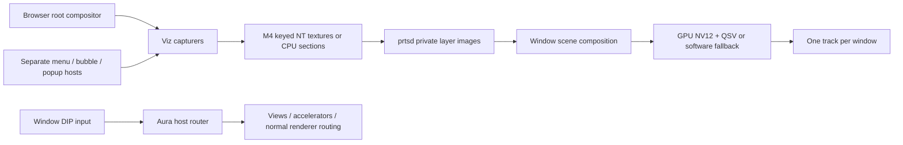

# Phase 2 M5 design: browser windows, Chrome UI and popup composition

Design only, 2026-10-20. No production implementation, build, runtime probe or
Chromium change was made for this document. Source inspection establishes the
entry points and their semantics; the acceptance gates below establish whether
the proposed combination works. Do not report those gates as passed.

Validated against `C:/src/chromium/src`, base PIN
`caef9db47e2cf3fe8e9f07ddceeff6ddf6957385` (158.0.8111.0), branch `work`,
HEAD `7ea7adb8afc725e49f8990b2683a9dff40fa609f`, patches 0001-0019.
Paths/line anchors below refer to that patched checkout. The primary input was
[chromium-output-investigation](https://github.com/FlysoftBeta/chromium-output-investigation),
cloned to `%TEMP%/prts/coi`, HEAD
`7476579f2ce0413c2708068a590c60d0b5983023`. Read its README, architecture,
interface, archived investigation, protocol header and all four patches.
Its patches target a different base (`f05e8113`) and were never built.

## Decision

One logical target and one outgoing WebRTC video track **per browser window**.
The base image is the browser's **root `ui::Compositor` FrameSinkId**, including
tab strip, omnibox, toolbar and embedded content. Tabs are metadata and commands,
not capture targets. An allowed `window.open` creating a new Browser creates a
new window stream; a Views menu is an auxiliary layer of its owner stream.

Choose popup option **(a)**: retain Chrome's existing widget/native parenting;
capture each additional host's root compositor once, export through M4, and
compose its image into its owner's base image in prtsd on D3D11 **before** GPU
BGRA-to-NV12 and QSV encoding. Same-host child widgets are already in the base
capture and MUST NOT be overlaid again. CPU capture and CPU composition provide
the same scene semantics. No popup video tracks or popup DOM overlays in the
viewer. Reuse M3/M4 leases, registration, credits, retirement, passive refresh,
keyed mutex keys and fallback machinery; change their identity and bounds.

Use normal compositor BeginFrames. Keep cloaked HWNDs as Windows plumbing;
they remain hidden and never receive OS input/focus. Capturing inside Viz does
not require eliminating the existing hidden DComp presentation. The optional
null-GPU-widget optimization is deferred, not a prerequisite for M5.

## Validated Chromium anchors

All UI/Views/Aura/host tracking and capturer control below run on the browser UI
sequence. Viz service/render code is on Viz/GPU sequences; inspect it for format
semantics, never call it directly from the browser. Pipe I/O stays on M1 workers.

| Area | Location and observed behavior |
| --- | --- |
| Browser lifecycle | `chrome/browser/headless/chrome_browser_main_extra_parts_headless.cc:22,39,47`: PRTS prepare/start/stop are already hooked. `chrome/browser/prts/prts_target_registry.cc:362,375,404` owns keepalives, Browser/tab observation and startup-tab cleanup. Extend this lifecycle. |
| Browser to host | `chrome/browser/ui/views/frame/browser_view.h:523,692` exposes native window/Widget; native Aura window `GetHost()` reaches the root compositor. Use `BrowserWindowInterface`/BrowserWindow's native window, not WebContents' renderer view. |
| Enumeration | `ui/aura/env.h:152`, `env.cc:267-273`, `env_observer.h:21,24`: enumerate existing hosts; initialized/destroyed notifications. `window_tree_host.cc:143` notifies during InitHost, before desktop native initialization finishes. |
| Root capture precedent | `content/browser/media/capture/aura_window_video_capture_device.cc:73-116`, `WindowTracker::ResolveTarget`: `root_window->GetFrameSinkId()`, `VideoCaptureTarget`, `CreateVideoCaptureLock`. Subtargets are for non-root window cropping; M5 captures the complete root without a subtarget. |
| Capturer creation | `components/viz/host/host_frame_sink_manager.h:248,256`: resilient client capturer; `ui/compositor/compositor.h:472`: `frame_sink_id()`, `:272`: pixel `size()`. `ui/compositor/Compositor`'s context factory supplies HostFrameSinkManager. Use `ChangeTarget(VideoCaptureTarget(root_id))` explicitly. |
| Root video/overlay interaction | `components/viz/service/display/overlay_processor_win.cc:380-384,514-521` avoids unreadable DComp-surface/delegated overlay paths when copy/capture is present; `components/viz/service/display/surface_aggregator.cc:922-929` propagates video-capture semantics. Root capture does not inherently require the investigation's null-widget output patch. Include animated video/WebGL pixels in acceptance. |
| Current source to replace | `chrome/browser/prts/prts_capture.cc:45-108`: Source currently observes WebContents, calls IncrementCapturerCount, resolves renderer sink and `view->CreateVideoCapturer()`. Replace Source ownership/targeting with host identity; retain export/credit code at `:266-401`. |
| Windows host creation | `ui/views/widget/desktop_aura/desktop_window_tree_host_win.cc:252-315`: creates HWND, compositor, InitHost; params.parent or context establish HWND owner at `:266-275`. `desktop_native_widget_aura.cc:589-766` registers content window, adds to host, creates capture/focus/position clients and parenting client. |
| Widget readiness | `desktop_window_tree_host_win.cc:317-335` has `OnNativeWidgetCreated(params)`; `desktop_native_widget_aura.cc:768-769` calls `OnWidgetInitDone`. Record params early, finalize registration after init, not inside OnHostInitialized. `views::WidgetObserver` methods in `ui/views/widget/widget_observer.h:32-111` cover visibility, activation, bounds, child and destruction. |
| Ordinary popup selection | `chrome/browser/ui/views/chrome_views_delegate_win.cc:124-160`: Windows generally chooses DesktopNativeWidgetAura for popups; elevation-based shadows can choose NativeWidgetAura. Therefore do not assume every popup has a separate host. |
| Menus | `ui/views/controls/menu/menu_host.cc:129-168`: TYPE_MENU, parent/context, inferred opacity, platform-rounded corners and shadow. `menu_controller.cc:2776-2814` supplies owner/context for nested menus. |
| Omnibox dropdown | `chrome/browser/ui/views/omnibox/omnibox_popup_view_views.cc:108-114`: translucent TYPE_POPUP with parent/context; `:758` expands bounds for custom-drawn shadows. |
| Bubbles / permissions | `ui/views/bubble/bubble_dialog_delegate_view.cc:183-221`, `CreateBubbleWidget`: translucent TYPE_BUBBLE, anchor/parent, activatable policy. `chrome/browser/ui/views/permissions/permission_prompt_bubble_base_view.cc:199-231` creates bubble and shows active/inactive according to policy. |
| Tooltips | `ui/views/corewm/tooltip_aura.cc:201-215`: TYPE_TOOLTIP with context, no native shadow. `desktop_window_tree_host_win.cc:348-349` creates TooltipAura. |
| Renderer popups | `content/browser/renderer_host/render_widget_host_view_aura.cc:490-529`: InitAsPopup creates WINDOW_TYPE_MENU, transient relation, ParentWindowWithContext, capture and parent scale override. `desktop_native_widget_aura.cc:233-275` parenting client creates an extra desktop parent for menus/fullscreen through `DesktopNativeWidgetTopLevelHandler::CreateParentWindow:108-170`. It passes context, including for renderer popups without a Widget parent. |
| Select vs other popups | `third_party/blink/renderer/core/page/chrome_client_impl.h:380-386`: external menus only under USE_EXTERNAL_POPUP_MENU; `content/public/common/features.gni:10` enables it for Android/Apple, not Windows. Windows follows internal page-popup path. Exercise select/date/color; do not apply the Mac PopupMenuHelper design to Windows. |
| Embedded dialogs | `chrome/browser/ui/views/javascript_tab_modal_dialog_view_views.cc:147` calls ShowWebModalDialogViews. Host identity decides whether it is in the root capture or a separate layer. Retain modal filtering. |
| Headless hidden HWND | `ui/views/win/hwnd_message_handler.cc:431` selects headless handler; `hwnd_message_handler_headless.cc:54-104` creates/cloaks HWND; `:233-292` changes logical visibility; `:383-394` changes logical activation only; `:431-440` fakes native focus and makes native capture a no-op. |
| Focus | `hwnd_message_handler.cc:1596-1605` handles initial headless focus without SetFocus. `desktop_native_widget_aura.cc:448-535` updates Aura activation, stored Views focus and InputMethod focus. Use that machinery, not renderer-only SetPageFocus. |
| Capture state | `ui/views/widget/desktop_aura/desktop_capture_client.cc:33-35,50-113`: global logical capture and per-root capture persist independently of native capture; changes notify other roots. |
| Geometry | `desktop_window_tree_host_win.cc:807-862`: GetBoundsInPixels is client extent with expansion removed; SetBoundsInPixels accounts for expansion. `:1364-1368` forwards size to Aura. `hwnd_message_handler_headless.cc:113-142` client/outer inset distinction; `:509-539` synthetic bounds/move/size notifications. |
| DSF | `ui/display/headless/headless_screen_manager.h:42-63`: public AddDisplay/UpdateDisplay/RemoveDisplay/SetPrimaryDisplay. `ui/display/win/screen_win_headless.cc:107-118` installs delegate; `:411-476,603-627` implements mutations. `ui/views/widget/desktop_aura/desktop_screen_win.cc:53-59` selects DesktopScreenWinHeadless. |
| DSF propagation | `ui/display/screen.cc:146-152` derives preferred scale from nearest display; `ui/aura/window_tree_host.cc:594-617,649-662` snapshots it, changes root/compositor size and responds to display metrics. `ui/display/display.cc:246-255` takes pixel bounds and stores scaled DIP bounds/native origin. |
| Native cursor side effects | `desktop_window_tree_host_win.cc:900-930` eventually calls OS SetCursor/ShowCursor/SetCursorPos; `hwnd_message_handler.cc:1046-1052` really calls SetCursor, with no headless exclusion. Suppression is required for desktop independence. |
| Headless stacking limitation | `hwnd_message_handler_headless.cc:229-231`: StackAbove/StackAtTop are no-ops. Capture ordering cannot be read from DWM. Observe requests at `desktop_window_tree_host_win.cc:444-452,585-590`. |

## Window registry and popup strategy

New `chrome/browser/prts/prts_window_registry.{h,cc}` owns Window entries by
BrowserWindowInterface identity, stable tab IDs, host associations and scene
snapshots. Keep useful M1 WebContents observation, opener discovery, navigation
and tab movement logic. Stop treating a WebContents as a stream/size owner.
Closing a window follows ordinary Widget/Browser close semantics, including
beforeunload/dialogs; report close-requested separately from actual destruction.
A prompt is not a five-second transport timeout: reply acceptance immediately,
then report actual closure or cancellation. Zero windows retains M1 keepalives.

New `PrtsHostTracker` uses EnvObserver plus the existing host list to discover
hosts. OnHostInitialized only adds a provisional record. A tiny generic opt-in
Views hook at `DesktopWindowTreeHostWin::OnNativeWidgetCreated(params)` copies
Widget identity, type, parent/context, opacity, rounded corners, shadow and
z-order; finalize on OnWidgetInitDone (or a posted UI reconciliation after init).
Do not start captures/use focus clients while they are still being constructed.
Observe the Widget and content/root Aura windows. OnHostDestroyed is a final
pointer-removal notification; stop captures earlier on Widget/window destroying,
before the compositor dies. Late callbacks use weak lifetime/generation tokens.
`AnyWidgetObserver` is passkey restricted (`any_widget_observer.h:206-214`);
do not use a test passkey or pretend it is an unrestricted production API.

Resolve owner using explicit Browser native-window membership first, then copied
params.parent/context, Widget parent, bubble anchor, transient-parent ancestry
and cached HWND owner relation, walking through auxiliary hosts to a managed
Browser. Context matters for renderer popups and tooltips. Reconcile after
reparenting/tab moves. Do not infer normal-window status from non_client_view()
(the investigation heuristic), titles, HWND creation order, or current input
window. A Browser-backed popup Browser/DevTools window is a Window, not a menu
layer. Unknown unrelated hosts are diagnosed and never assigned to another
window opportunistically. In-session owned Chrome dialogs must resolve before
M5 can pass; add explicit association at their creation site if a case lacks it.

Deduplicate by **host root**, not Widget. A child sharing an owner's host adds
no layer. A separate host adds a Layer with owner window, source id, parent
layer, root-relative signed DIP rect, pixel size, DSF, visibility, input policy,
z-index and source generation. Chromium sends complete atomic scene snapshots
on open/hide/show/move/resize/restack/close. Hidden and destroyed are distinct:
menus/omnibox widgets can be reused. Subscribe visible layers automatically
with their window; a popup never requires a new viewer subscription.

Maintain virtual order: owner below descendants; preserve Aura sibling order
within a host; across hosts apply z-order level and observed StackAbove/StackAtTop
requests, show/activation order as deterministic tie breaker. Add notifications
at the validated Windows stacking methods because headless implementations drop
the requests. A reused menu shown again moves to the appropriate top position.
The same registry supplies input hit testing, so pixels and event routing agree.
Do not globally overlay every auxiliary host over every browser window.

Chrome itself also queries the headless Screen: menus use GetWindowAtScreenPoint
(`ui/views/controls/menu/menu_controller.cc:3754`), but
`ui/views/widget/desktop_aura/desktop_screen_win_headless.cc:108-128` searches
hosts in creation order. Add a generic opt-in query delegate there to consult
the same virtual stack and descend the selected Aura root, respecting the
ignore set and visible/input policy. Otherwise the router could choose the
right host while menu internals choose a different reused popup. Ordinary
headless behavior stays unchanged without the delegate.
Likewise, route `DesktopWindowTreeHostWin::IsStackedAbove:607` to virtual order
for PRTS hosts; its stock implementation compares native HWND stacking, which
does not follow the headless no-op stack requests.

Each window gets its own virtual display/work area, with the streamed root
client rectangle as the usable area. Chrome's menu/bubble placement should flip,
scroll or constrain to this area. Clamp separate owned dialogs/hosts to it after
layout if necessary, preserving anchor and updating hit-test geometry. Fixed
stream size means pixels outside this rectangle are clipped. Test edge menus,
nested menus and a popup larger than the available area: constrain/scroll it,
or explicitly reject an unsupported too-small window size; never silently crop
an interactive control needed to dismiss/complete a dialog. Protocol reports
actual accepted minimum dimensions. Native frame borders/DWM shadow outside
the root client surface are not stream pixels. Tab strip and Chrome-drawn
caption controls ARE part of the root. Inspect these pixels before signoff.

For a Chrome-owned Views dialog that still chooses a system-painted titlebar,
select a Views frame in the PRTS-only pre-init adapter rather than trying to
capture DWM titlebar pixels. `ChromeViewsDelegate::OnBeforeWidgetInit:184` can
delegate this policy to a new PRTS file;
`ui/views/widget/native_widget_delegate.h:156` exposes AsWidget,
`ui/views/widget/widget.h:1213` exposes set_frame_type(kForceCustom), and
`ui/views/window/dialog_delegate.h:484` / `ui/views/window/dialog_delegate.cc:328-330`
select a custom dialog frame. Apply before NativeWidget initialization, retain
modal/parent semantics and accept/cancel controls, and test close/titlebar pixels.
This changes dialog decoration only, not popup parenting. Ordinary Browser
Chrome already draws its controls (`browser_frame_view_win.cc:127`); do not
blanket-replace Browser frame layout.

### Alpha, corners and shadows

Base is opaque BGRA. Auxiliary layers use premultiplied BGRA alpha, composited
with `Cout = Cs + Cd * (1-As)` (D3D11 ONE / INV_SRC_ALPHA), in z-order, onto a
fresh copy of the base; never accumulate popup blending on the prior composite.
Pixels outside the captured visible rect are transparent; use exact constraints
and crop padded capture allocations so capturer black letterboxing is never
treated as popup content. Do not convert each popup to NV12 independently.

The path is plausible in source: `gpu/command_buffer/common/shared_image_info.h:48-63`
defaults single-plane images to premultiplied alpha; Viz GMB pool creation at
`components/viz/service/frame_sinks/gmb_video_frame_pool_context_provider_impl.cc:61-75`
uses it; Skia RenderSurface at
`components/viz/service/display_embedder/skia_output_surface_impl_on_gpu.cc:1135-1159`
clears transparent for nonopaque sources then draws. CopyOutputRGBA discards
alpha only for emulated RGBX (`:1702-1718`). This is **not** an alpha runtime test.
Gate GPU and CPU paths with a known translucent popup over colored base pixels.
M4 `chrome/browser/prts/prts_capture.cc:374-381` currently forces CPU alpha to
255: make that conditional on opaque sources, preserve it for format 2 layers.
Keep BGRA channel normalization and validate premultiplication.

Views-drawn bubble/omnibox shadows are already in their expanded compositor
bounds. DWM/native drop shadows and platform-rounded clipping are **not** in
Viz pixels. For the latter, export params.rounded_corners/shadow policy and
apply a rounded mask plus a bounded deterministic shadow in prtsd (CPU equivalent).
Do not add another shadow when the Widget draws its own. Carry shadow insets
separately from interactive bounds. Widget layer opacity/animations must be
tested. At this PIN `DesktopWindowTreeHostWin::SetOpacity:741-742` changes the
content layer; omnibox animations change their layer at
`omnibox_popup_view_views.cc:132-146`, so these are already in captured pixels
and Layer.opacity is 1. Only a separately proven compositor-external opacity
may use that metadata field; never sample the layer opacity and apply it twice.
A PRTS-only Views
painted border is an acceptable later replacement if a case cannot expose its
native decoration cleanly. Opaque black popup corners are a failing result,
not a permitted fallback. Mixed GPU/CPU sources still compose all visible layers.

### Synchronization and resources

There is no atomic frame timestamp across independent compositor roots. Choose
bounded latest-complete composition, not lockstep BeginFrames. Each frame is
associated with immutable source generation/geometry revision from its capture
epoch. Invalidate/restart an epoch on resize, sink replacement or any change
that makes its old pixels incompatible; late callbacks cannot relabel old pixels
with a new revision. Moving an unchanged-size cached layer can reuse its pixels
under the new transform. Scene snapshots have a strictly increasing revision.

prtsd imports/copies each complete layer to a private cached image, completes
GPU reads, returns key 0 and FRAME_RELEASE immediately. Cached images never
hold browser credits while waiting for another layer or an encoder. One cache
per live source, plus immutable refs needed by the in-flight composite. On any
base/layer/scene update mark the owner dirty. Emit at its FPS ceiling using the
latest compatible complete base and layers. A popup-only change must encode
even when the base is static. Hide/destroy recomposes from cached base immediately
and invalidates the old layer; late frames are released and ignored.

On popup show request a full refresh. Allow up to 100 ms for its first frame,
keeping the preceding complete scene while waiting; then continue the base and
report a missing-layer diagnostic, retrying refresh. No infinite wait or frozen
base. M5 acceptance requires appearance within 250 ms on the reference host;
a persistently missing required popup fails qualification. Resize starts a new
window generation, discards incompatible caches and gates output on a new base.
Never stretch an old popup over new dimensions. Some one-frame temporal skew
between animated independent roots is accepted; exact simultaneous animation is
a deferred feature requiring more Viz coordination. Record frame ages/skew.

Retain all M4 keyed-mutex/registration rules, including stale-frame acquire-1 /
release-0 before ACK, browser-local handle duplication and fatal uncertainty
after acquisition. GPU failure before acquisition retains per-source sticky CPU
fallback; it must not make the whole popup disappear. Window resize/close drains
old resources normally. No UI/pipe waits on encoding. M4's bounded browser GPU
completion waits remain a known responsiveness limitation.

M3's **two resources for the entire instance** cannot support two windows plus
menus. Change only that capacity policy: negotiated resource count and total
byte budgets, one resource per auxiliary source and one or two per base; retain
global negotiated in-flight descriptor credits (1..3). Schedule ready sources
fairly with first-popup refresh priority and a bounded round-robin base interval.
Retired allocations count against the budget until destroyed. Stop/unregister
hidden layers after outstanding releases; retain at most their bounded private
cache for reuse, evictable immediately. Enforce total private/cache/composite
memory too. No per-tab pools and no unbounded per-popup allocation. Advertise
limits; a rejected allocation is explicit resource_exhausted, not silent omission.

## Input, accelerators, logical focus and cursor

New `prts_window_input.{h,cc}` validates M2's schema/held-state/queue bounds, but
addresses Window id/generation. Coordinates are root-window **DIPs**. The viewer
maps the visible video rectangle (excluding object-fit bars) to window DIP
bounds, independent of the viewer's DPR. Router converts through virtual screen
coordinates to the selected host, then uses host DIP-to-pixel transform exactly
once. `WindowEventDispatcher::OnEventProcessingStarted:510-522` converts source
host pixels back to root DIP with its inverse transform (`:293-297`). Supplying
raw DIP directly to SendEventToSink at DSF2 would be wrong.

Select destination in this order: live logical capture host
(`DesktopCaptureClient::GetCaptureWindowGlobal`), modal/active transient rules,
then topmost input-accepting popup under the pointer, then base. Tooltip/shadow
regions do not intercept. Use Widget/content-window visibility, not merely the
host root's IsVisible (host Init shows the root before its Widget is shown).
Capture can extend outside the video. A capture held
by another window requires an explicit logical input-window switch/cancel;
never send a window A event into window B merely because global capture says B.
One control owner/input window per instance matches Aura's process-wide pointer,
menu and capture state; all window streams remain independently live.

Construct MouseMoved/MouseDragged, MousePressed/Released, changed button flags,
held flags, timestamp and click count; map protocol modifier bits explicitly.
Dispatch through `host->SendEventToSink(&event)` as native Windows does at
`desktop_window_tree_host_win.cc:1387-1394`. Aura supplies child hit testing,
Views delivery and normal RWH/OOPIF routing. On cross-host pointer changes send
one exit through old sink then a move into the new one; let Aura generate child
enter/exit (`window_event_dispatcher.cc:985-1014`). Refresh hover when a popup
opens/closes under a stationary pointer. Update headless Screen's synthetic
cursor position alongside Aura Env state; `ScreenWinHeadless::GetCursorScreenPoint`
reads its own stored point (`screen_win_headless.cc:145-151`), not Env's. Adapt
the existing testing setter to a production generic setter or isolate its use
inside the PRTS adapter. Never call OS SetCursorPos.

Wheel input remains positive down/right DIP pixels. For the existing M2 wheel
messages choose a **non-native ui::MouseWheelEvent** with
EF_PRECISION_SCROLLING_DELTA, integer pixel offsets `(-delta_x,-delta_y)` and
per-axis fractional remainders. Location is host pixels; offsets stay DIP pixels.
`ui/events/event.h:661` documents positive left/up offsets;
`ui/events/blink/web_input_event.cc:456-479` copies non-native offsets directly
and honors the precision flag. The 120-unit native-message path is different
(`ui/events/win/events_win_utils.cc:402-407`, `ui/events/event.cc:671`); do not
multiply remote pixel deltas by 120. Retain ordinary renderer phase scheduling
and verify sign/amount in Views lists and content at DSF1/2. A future
ui::ScrollEvent supports floating precision/trackpad phases
(`web_input_event.cc:105-124`) but Views fallback can round it
(`ui/events/event.cc:597-601`); do not dispatch both forms.

Focus/activation is logical. On an explicit FOCUS(true)/input-window switch,
deactivate the previous Browser Widget, cancel its menus/capture, then activate
the new one using headless Widget/Aura machinery; restore its stored FocusManager
view. Do not focus WebContents before every event (that would steal omnibox
focus). An activatable dialog becomes the keyboard destination; a nonactivating
menu remains under its owner's key/pretarget processing. On blur/disconnect,
release held inputs, cancel menu mode/capture and deactivate logically. Do not
use SetForegroundWindow, SendInput, PostMessage or OS keyboard hooks.

Keys are ui::KeyEvent with explicit KeyboardCode, DomCode, DomKey, flags/repeat,
timestamp and no native Windows message. Set EF_IS_SYNTHESIZED for remote keys
to bypass server IME queue peeking in `WindowEventDispatcher::PreDispatchKeyEvent`
(`:1093-1112`); normal Aura pretarget/Views accelerator dispatch still runs.
`FocusManagerEventHandler::OnKeyEvent` (`ui/views/widget/focus_manager_event_handler.cc:25`)
and `FocusManager::OnKeyEvent` (`ui/views/focus/focus_manager.cc:56-149`) process
accelerators. Ctrl+T/L/W map to IDC_NEW_TAB/FOCUS_LOCATION/CLOSE_TAB at
`chrome/browser/ui/accelerator_table.cc:59,68,69`. Do not carry M2's unconditional
skip_if_unhandled into the normal renderer path; it suppresses browser fallback.

Committed text is separate from keydown; down.text is informational only.
Resolve the **current host InputMethod's current TextInputClient** each time.
For one ordinary UTF-16 character use TextInputClient::InsertChar with a char
KeyEvent to retain keypress behavior; for multi-character/IME commit use InsertText
with MoveCursorAfterText, only if TextInputType is not NONE. RWHVA InsertText
CHECKs this (`render_widget_host_view_aura.cc:1658-1672`); it forwards to the
TextInputManager active widget, covering focused OOPIF. Single-char path is
`:1675-1700`; Views Textfield implementations are `textfield.cc:1776-1816`.
Do not send a synthetic char through the synthesized-key bypass: desktop native
widget drops char events (`desktop_native_widget_aura.cc:1494-1500`). Local
viewer IME owns candidate UI. Optional composition uses SetCompositionText /
ClearCompositionText on that same client, with bounded UTF-16 selection ranges;
advertise only after commit/cancel/focus-change acceptance. Default M5 supports
committed text, matching M2. Enter/Tab/Backspace are key events; content Enter
also needs its single char/default-action sequence if the normal path expects it
(`render_widget_host_view_event_handler.cc:258-265`): synthesize it only when
unconsumed and directed to content, never after an omnibox/menu accelerator.

Preserve M2's ordering fix: UI dispatch returning is not a renderer focus ACK.
Before content-bound text/key after a pointer focus change, wait for normal
renderer dispatch/ACK and text-input state to settle. Use public
RenderWidgetHost::InputEventObserver (`content/public/browser/render_widget_host.h:242-276`)
plus a small content-side **completion observation** adapter for asynchronous
Aura/OOPIF routing where needed, with the same five-second bound and weak epoch
as M2. Attach to relevant live widgets before dispatch; correlate forwarded
events, not just any ACK or an empty observer set. Views-consumed events complete
synchronously and must not wait for a renderer ACK that will never arrive.
ImeCommitText needs a processing barrier too, as M2's adapter already provides.
Do not issue a second RWH injection as a synchronization workaround. Acceptance
must send click/down/char/up without sleeps, including an OOPIF focus change.

The adapter can live beside `content/browser/renderer_host/synthetic_input.cc`
without exposing Chrome internals. Its additional hook observes the **existing**
routed event completion: `RenderWidgetHostInputEventRouter::RouteMouseEvent`
(`components/input/render_widget_host_input_event_router.cc:674-681`) enters
RenderWidgetTargeter, while `DispatchMouseEvent:684` has the final target. Track
the unique remote event timestamp/type through that route, explicitly complete
target-lost/no-consumer outcomes, then wait for its final target ACK. Do not
require kFromDebugger as M2's private injector currently does: normal Aura
events do not set it. A process-input barrier exists at
`RenderWidgetHostImpl::WaitForInputProcessed` (`content/browser/renderer_host/render_widget_host_impl.cc:1825`),
but `components/input/input_router_impl.cc:898-903` warns it does not flush
browser-side queues. Use it **after** routing/ACK, with TextInputManager's
OnUpdateTextInputStateCalled observation (`content/browser/renderer_host/text_input_manager.h:49,307`)
to resolve the current text client; it alone cannot replace routing completion.
Keyboard/IME completion follows the same epoch. This is a narrow observation
hook, not a new synthetic gesture implementation.

Keep M2's content adapter internally for legacy v1 tests and reusable validation /
completion code during migration. v2 exposes exactly one Aura input route.
Remove the direct page route from normal production use after v2 qualification;
do not maintain two independently delivered inputs or two competing cursors.

Cursor reporting moves to the selected window-level cursor. Add an opt-in
generic callback/consume hook at SetCursorNative and cursor visibility/warp
methods (`desktop_window_tree_host_win.cc:900-930`), **before** native side
effects. Native cursor manager broadcasts to hosts; associate updates with the
router's hovered/capture host, not every host's callback as a new window cursor.
Combine Views and content cursor selection, visibility and popup changes.
Preserve M2 built-in cursor wire shapes; custom cursor remains unadvertised
until tested with bitmap alpha/hotspot/DSF. Suppress OS SetCursor, ShowCursor,
SetCursorPos for all hosts in the opted-in PRTS headless process, including
provisional hosts before owner association. Register hooks before first Widget
creation. Explicitly disable UseCursorEventHook for PRTS
(`ui/base/ui_base_features.cc:171-176`), so physical desktop visibility changes
cannot override the remote logical cursor. Pointer lock/raw OS input, native drag/drop
and native move loops are unsupported in initial M5; prevent entering them.
Ordinary captured text selection/slider drag must work.

## Window size, DSF and desktop independence

Size means the **root compositor client extent in DIP**, not page CSS viewport
and not outer HWND bounds. Device extent is ceil(DIP * DSF); read actual root
and compositor geometry back after layout and publish the accepted size. Page
viewport is smaller by Chrome UI insets; page zoom is independent. Remove M1
Emulation.setDeviceMetricsOverride from v2 tabs; it only scales content and can
mask broken UI scaling. Do not fake whole-window DPR by scaling capture output.

Use `PrtsVirtualDisplayManager` (new Chrome PRTS file) over existing
HeadlessScreenManager. Reserve a non-streamed primary display, allocate a distinct
virtual display/work area and separated virtual origin for each Browser window.
Keep DIP and physical display rectangles disjoint at all permitted DSFs, with
bounded signed coordinates and a gutter; use Screen conversion APIs rather than
origin*dpr arithmetic (mixed-scale multi-monitor mapping is not that simple).
SetScaleAndBounds takes pixel geometry. Set work area to the stream rectangle.
Place the browser and its owned popup family on its display; initial widget
creation may need a creation-context association before Browser registration.
Allowed user-created Browser windows are adopted and moved to a fresh display
before their first published frame. This never moves/shows a real desktop window.

Resize/DSF transaction on UI: suspend input/capture publication, cancel held state
and transient menus, increment window generation, update virtual display scale /
bounds, apply client size (translate outer/client insets through Widget/host APIs),
let normal display/host notifications update Views and renderer ScreenInfo,
verify root DIP extent, compositor pixel extent and DSF, then restart captures
and emit WINDOW_CHANGED before resize response. Geometry notifications can be
reentrant; publish one reconciled snapshot. Use fractional-DSF/odd-size tests to
settle rounding; never call compositor SetScaleAndSize alone (it leaves host /
Screen / input transforms inconsistent). Drain old keyed resources across the
transaction. Closing the last owner removes its auxiliary displays after hosts
are destroyed; never remove the reserved primary (ScreenWinHeadless CHECKs it).

Headless invisibility is source-supported but requires an expanded runtime gate:
enumerate **all** browser-tree HWNDs while opening menus, tooltips, permission and
modal dialogs; verify native hidden/cloaked states, no taskbar button, foreground
sentinel and physical cursor unchanged. M1/M2 connected-desktop focus remains
unqualified; disconnected NULL foreground is not a pass. Root capture includes
Chrome pixels without exposing those HWNDs on the desktop.

Native OS dialogs/toasts are not Aura capture sources. At this PIN
`chrome/browser/chrome_browser_main.cc:1813-1818` already installs
HeadlessSelectFileDialogFactory; its implementation
`components/headless/select_file_dialog/headless_select_file_dialog.cc:39-52`
auto-cancels. Keep that safe behavior for M5; a file-transfer/remote chooser is
separate work, not promised by window capture. Views JavaScript/auth/dialog UI
must be captured and operable. Disable system notifications for PRTS (Windows
bridge checks both NativeNotifications/SystemNotifications at
`chrome/browser/notifications/notification_platform_bridge_win.cc:1195-1196`).
Block native print/system-menu/external-protocol/WebAuthn/EyeDropper launch paths
or provide an in-stream replacement before enabling them. Do not assume flags
cover all native UI or implement an after-the-fact HWND closer as prevention.
Audit existing headless guards case by case. The first M5 patch includes a
no-OLE drag client at `DesktopWindowTreeHostWin::CreateDragDropClient:352`, whose
normal Windows client calls `::DoDragDrop` at `desktop_drag_drop_client_win.cc:132`,
and a PRTS guard against `RunMoveLoop:657`. Document disabled capabilities.

## Protocol, daemon and frontend

The proposed **v2.0 window contract** is specified in
[protocol.md](protocol.md#m5-proposed-v20-window-contract-design-not-implemented).
It overrides the old page/active-target model only when v2 is negotiated; never
reinterpret a v1 target id as a v2 Window/Layer silently. v1 remains historical
and testable during migration. New window/tab/scene records use new message IDs;
resource/frame payload layouts stay reusable with source id replacing target id
under v2 and format 2 identifying premultiplied BGRA. Input targets Window IDs.

prtsd changes are concentrated in `model.rs`, `browser_wire.rs`, `browser.rs`,
`browser_frames.rs`, `frame_source.rs`, `video.rs`, `daemon.rs`, `viewer.rs` and
new `window_scene.rs`/D3D11 compositor module. The present singleton `Video` and
BrowserSource's single `subscribed` are insufficient: use a map WindowId ->
scene caches, Video/encoder worker, publication, metrics and viewer count.
One browser ingress owns all resources and demultiplexes by source; workers
must not steal another window's static frame. Serialize immediate-context work
on the existing matching D3D11 device. Composition output is a private BGRA
texture with shader-resource/render-target binds; submit it to existing NV12
conversion. Keep encoder-retained surfaces independent of layer caches/exports.
Software fallback composites BGRA using the same masks/order before I420/NV12;
CPU layers may upload for QSV, explicitly reported. Budget private images,
encoder surfaces and composite ring; do not hold the browser Session mutex
during encoding/composition or GPU waits.

For least signaling churn, keep one PeerConnection/video track per viewer
session and bind session.create to one immutable window_id. Viewing two windows
uses two sessions/tracks; all viewers of a window share its encoder publication.
This fulfills per-window tracks without dynamic transceiver renegotiation.
Existing active-target switches stop changing a session's video. Window close
ends its sessions/track; tabs switch inside the same video. Per-window FPS,
PLI/refresh, bitrate and stats replace instance-global media state. Instance
network caps must be divided across windows, not granted in full to each encoder.

Node forwards window/scene/tab events and window-bound session commands.
Frontend `server/public/app.js`, `input.js`, `index.html`, `style.css` show window
cards/videos; each has size/DSF, tab metadata and controls, its own input mapping
and cursor. Chrome's tab strip remains authoritative UI. A shared control owner
selects one input window; windows can all remain visible. Browser-reserved
Ctrl+T/L/W may be intercepted by the **local** viewer browser: provide explicit
remote shortcut buttons and acceptance that sends those key events over the
control channel; use Keyboard Lock only when supported and permitted. Never
claim preventDefault captures all reserved browser shortcuts. Mouse click on
remote tabs/omnibox works without that facility.

## chromium-output-investigation mapping

Adopt means reuse the idea, not apply its unbuilt patch. This table includes
P1-P8, all four patches and relevant archived alternatives. Source anchors are
at our PIN/work checkout; provisional new PRTS interfaces are not upstream APIs.

| Investigation hook / patch | Decision | Validated location and reason |
| --- | --- | --- |
| 0001 / P1 null root GPU widget | Defer/reject for initial M5 | `content/browser/compositor/viz_process_transport_factory.cc:421-424`; `skia_output_surface_dependency_impl.cc:94-95`; GL/Dawn offscreen branches `skia_output_surface_impl_on_gpu.cc:1971,2142`. Hook exists, but changes output backend/scheduler; capture and desktop invisibility already work without it. Separate optimization with GPU/video/alpha tests. |
| P1 software offscreen | Adopt existing behavior | `output_surface_provider_impl.cc:140-145`: headless uses SoftwareOutputDevice. No extra null-HWND patch required for CPU fallback. |
| 0002 generic Views hooks | Adapt | `desktop_window_tree_host_win.cc:317,339,444,451,585,900-930`: small observer/consume interface with Chrome implementation, extended for init metadata, stacking and suppression. No ui->chrome dependency or monolithic CloudStream singleton. |
| 0002 / P4 cursor callback | Adapt | `SetCursorNative:900`; `hwnd_message_handler.cc:1046-1052`. Observe **and suppress** native changes, plus visibility/warp; include Views/popups and selected host, replacing M2 content-only cursor. |
| 0002 / P5 OLE replacement | Adopt restricted first version | `CreateDragDropClient:352`; `desktop_drag_drop_client_win.cc:78-132`. No-op remote-mode client avoids OS modal loop; captured selection stays enabled; full data drag/drop deferred. |
| 0002 / P7 external BeginFrame | Defer | `WindowTreeHost::CreateCompositor:543`; `Compositor::IssueExternalBeginFrame:766`; transport factory `:410`. Real hooks exist, but not needed for bounded latest scene or FPS throttling; no HeadlessExperimental bridge added. |
| 0003 / P2 headless startup | Adapt/reuse M1 | `chrome_browser_main_extra_parts_headless.cc:22,39,47`. Existing PRTS lifecycle already covers prepare/start/stop; no second controller or transport. |
| 0003 / P3 Env host enumeration | Adopt/adapt | `env.h:152`, `env.cc:267-273`; `window_tree_host_observer.h:22-45`. Add readiness/destroying phases and Widget/Aura observations missing from patch; initial host notification is too early. |
| 0003 WindowStream root sink | Adopt/adapt | `aura_window_video_capture_device.cc:80-99`, `compositor.h:472`, `host_frame_sink_manager.h:256`. Root target and video-capture lock; replace WebContents Source only. |
| 0003 ARGB + native preference | Reject enum / adapt format | `frame_sink_video_capturer_impl.cc:1161-1175,1399-1407`: native-handle preference is Linux-only; Windows uses M4 kPreferMappableSharedImage, without browser CPU mapping. |
| 0003 raw GMB token export | Reject transport | `chrome/browser/prts/prts_d3d.cc` M4 adapter and `prts_capture.cc:266-401` export pool already implement verified copy/key0/1 lifetime. Do not send unsynchronized raw Viz textures or an unbounded token cache. |
| 0003 / P6 fence/sync TODO | Replace with M4 | `prts_capture.cc:356-370` guarded export copy plus explicit completion; `prts_d3d.cc` owns source/export mutex protocol. Do not rely on absence of observed tearing as proof. No new shared-fence wire mode. |
| 0003 CPU frames dropped | Reject | `prts_capture.cc:371-383`: CPU section fallback already exists. Preserve popup alpha and implement CPU blending; loss of GPU must not lose UI. |
| 0003 parent/nonclient classification | Adapt | `desktop_window_tree_host_win.cc:266-275`; renderer popup parent creator `desktop_native_widget_aura.cc:108-170`. Widget parent alone misses context-only hosts; nonclient view is not Browser identity. |
| 0003 position, last-created-on-top composition | Adapt | host bounds `:807-862`, stacking `:444-452,585`, headless no-ops `hwnd_message_handler_headless.cc:229-231`. Export relative transforms and explicit virtual order, visibility and decoration, not native z-order guesses. Also delegate `desktop_screen_win_headless.cc:108-128` queries to this order for menu internals. |
| 0003 named-pipe/PID OpenProcess/locked UI writes | Reject | Existing `chrome/browser/prts/prts_pipe_client_win.{h,cc}` M1 owns inherited anonymous pipes and worker writers; daemon duplicates from retained browser process handle. Avoid PID-based authority and synchronous UI WriteFile. |
| 0003 SetWindowBounds | Adapt | host `SetBoundsInPixels:824`; headless bounds `:509-539`. Use full-window DIP/client sizing plus virtual display DSF and generation transaction, not arbitrary physical coordinates from clients. |
| 0003 / P2 remote SelectFileDialogFactory | Defer remote chooser, retain existing cancellation | `chrome_browser_main.cc:1813-1818`, `components/headless/select_file_dialog/headless_select_file_dialog.cc:39-52,66-69`: PIN already has headless cancellation, absent from investigation assumptions. ui factory override remains possible at `select_file_dialog.cc:84`. |
| 0003 clipboard bridge | Defer | `chrome_browser_main_extra_parts_headless.cc:22` existing headless clipboard setup. No client clipboard protocol in M5; retain process-local clipboard. |
| 0003 downloads / native notifications / printing / external UI | Adapt boundary policy | Windows notifications `notification_platform_bridge_win.cc:1195-1196`; headless chooser above. Disable unsupported native launches; Chrome-rendered preview/dialogs use host registry. Full download/file/system integrations are separate capabilities, not captured by EnvObserver. |
| 0003 non-Aura HWND close-after-creation fallback | Reject prevention claim | Env only sees Aura hosts (`env.cc:267`). A visible OS dialog can appear before a watchdog closes it; prevent unsupported launches and use desktop acceptance to discover missed paths. |
| 0004 RemoteInput sink mouse | Adopt/adapt | host `HandleMouseEvent:1387-1394`, dispatcher `:510-522,985-1014`; add popup hit/capture routing, transforms, hover, validation and teardown; retain M2 flags contract. |
| 0004 wheel raw 120 units | Adapt | `events_win_utils.cc:402-407`, `event.cc:671`, host `HandleScrollEvent:1554`. Define DIP-pixel conversion/precision and verify direction in both Views/content. |
| 0004 key injection/layout-derived DomKey | Adapt | `ui/events/event.cc:847-858`, dispatcher `:1093-1112`; explicit DomKey + synthesized-key IME bypass, Views accelerators, no OS queue/layout dependency. |
| 0004 committed text / composition | Adopt/adapt | `TextInputClient`, `RWHVA::InsertText:1658`, Textfield `:1776`; guard TEXT_INPUT_TYPE_NONE, focus/ACK ordering and Unicode, local IME, optional preedit. Not unconditional silent drop or unsafe client InsertText. |
| Archive aura compositor vs page capture | Adopt root variant | `aura_window_video_capture_device.cc:93` explicitly chooses root; supersedes Phase 0 page-surface selection. |
| Archive Ozone PlatformWindowDelegate::DispatchEvent | Defer portability only | `ui/aura/window_tree_host_platform.cc` OnEvent/DispatchEvent feeds Aura; `ui/platform_window/platform_window_delegate.h` declares DispatchEvent. Windows `build/config/ozone.gni:11` excludes Ozone. Reuse ui event/sink abstraction, not an Ozone port. |
| Archive Ozone headless surface/pixmap | Reject Windows backend | `ui/ozone/platform/headless/headless_surface_factory.cc:145,256-263` creates TestPixmap, no Windows NT export; `headless_window.cc` is an Ozone PlatformWindow implementation. It cannot provide Chrome Windows UI by enabling a switch. |
| Archive headless_shell root parenting | Reject as replacement; informs alternative (b) | `headless/lib/browser/headless_window_parenting_client.cc:21-25` returns root, whereas unified Chrome Windows menus create hosts (`desktop_native_widget_aura.cc:262-272`). headless_shell omits real Chrome Views UI. |
| Archive headless platform/window host | Reject replacement; reuse conceptual separation | `headless/lib/browser/headless_window_tree_host.cc:19-26,51-59,91-117` creates compositor with optional external BeginFrames, synthetic bounds and no-op native capture/cursor; useful precedent, but it belongs to headless_shell, not the Chrome Views Windows host required by M5. |
| P8 Offscreen SharedImage ring / custom OutputPresenter | Defer | `skia_output_device_offscreen.cc:72-98` manages private backing/presentation; Windows branch selection above. More GPU-process lifecycle/sync/backend work than reusing M4 capturers. |
| Archive RWH/CDP input, WGC/DWM, Present/DLL hook, CEF/Electron OSR | Reject for M5 main path | RWH misses Views; desktop sink at `desktop_window_tree_host_win.cc:1393` includes them. Root Viz capture precedent avoids DWM and injection; replacement embedders/output hooks add work and still need separate popups. No external latency/portability claims adopted without measurement. |

## Rejected alternatives and portability

Forcing every menu/bubble into the main layer tree (option b) looks simpler for
capture but changes Chrome semantics: factory chooses desktop widgets expressly
to exceed parent bounds and support effects (`chrome_views_delegate_win.cc:146-152`),
and renderer menus bypass that factory through CreateParentWindow. It needs
multiple parenting changes, focus/capture/modal/coordinate repairs and clipping
tests. Reparenting already initialized layers is still more fragile. Do not
implement a partial conversion that captures only some popup types. A future
single offscreen virtual desktop compositor could aggregate roots in Chromium,
but requires new Viz embedding/input ownership and synchronization work.

WGC/desktop duplication/OS input violate the chosen desktop-independent path.
Custom output devices and external BeginFrames optimize later; they do not
solve popup ownership or Views input. New PRTS files plus a small generic Views
hook interface concentrate version-sensitive code. Keep platform-neutral scene,
IDs, validation and input semantics separate from Windows HWND/cursor/drag
guards and D3D11 import/composition, so a future Ozone/Linux implementation can
reuse the window contract with its own platform event/texture adapter.

## Ordered implementation and acceptance gates

Every step is a small reviewable change, not permission to combine all hooks
and hope E2E catches them. Keep intermediate v1 smoke tests runnable. Use detached
incremental chrome builds, existing M4 acceptance tooling and explicit logs.

| Step | Change | Acceptance before next step |
| --- | --- | --- |
| 1 | Define v2 codecs/capabilities and stable Window/Tab/Source IDs; add registry while v1 remains available. Native-side-effect guards and unsupported native-operation policy land with first enabled Aura input. | Unknown/stale/cross-owner IDs and malformed v2 records rejected; negotiation cannot silently downgrade whole-window clients; enumerate two Browsers with several tabs, tab move/replacement preserves IDs; zero-window recreation works. No production capture change yet. |
| 2 | Root-host capture adapter and virtual-display size/DSF manager; single opaque window through M4 GPU/CPU paths. | Exact decoded base contains tab strip + omnibox + toolbar + colored page at known different ROIs; sizes 960x640 DIP @1/@2 and fractional 1.25, odd dimensions; assert actual compositor size/DSF, page DPR, smaller inner viewport; resize generation/resource drain, static PLI refresh; no per-tab Emulation override. Connected desktop hidden/cloaked/taskbar/focus/cursor checks. |
| 3 | Aura pointer/key/text router, logical focus, cursor hook and completion barrier. | Click two real tab-strip tabs and verify both metadata/decoded page color; click omnibox, type local URL + Enter; Ctrl+L selects address, Ctrl+T creates tab, Ctrl+W closes it; no-sleep page and OOPIF click/type with exact single insertion, Unicode commit, Backspace/Enter; wheel sign/precision at DSF1/2, hover/exit/cursor over UI/page, captured selection outside video, blur/owner-loss releases, close/navigation races. Confirm OS cursor and foreground unchanged. |
| 4 | Host family discovery, readiness/destruction tracking, atomic scene snapshots, fair bounded source pools. | Inspect app menu/context menu/omnibox dropdown/bubble/tooltip/renderer popup creation; correct owner and host deduplication; show-hide-reuse-restack nested menus; standalone popup Browser gets its own window, unrelated host never crosses owners; one-credit case progresses with static base + popup; caps and retired allocations stay bounded. |
| 5 | GPU popup alpha/mask/shadow composition and equivalent CPU path; automatic layer subscriptions. | App menu opens by real toolbar click and is visible in **decoded video**, right-click context menu visible and clickable, select popup visible/change selection, secure-origin permission request shows Chrome bubble (no auto-accept flags), omnibox suggestions, tooltip, JS modal dialog, nested menu at window edge. Check known colored/alpha ROIs: popup interior changes, rounded corners retain base, shadow blends rather than black rectangle; GPU/CPU reference blend agrees before codec and within codec tolerance after decode. Popup-only updates encode on static base; close restores exact base with no ghost; <=250 ms show gate; no missing-layer diagnostics. |
| 6 | Per-window daemon Video/encoder/publication, window-bound sessions, frontend window cards. | Two windows concurrently stream distinct decoded colors and full Chrome UI on separate tracks; tab switch affects only owner stream; menu in A never appears/receives clicks in B; DSF1 A and DSF2 B concurrently, resize A while menu/B animation runs; switch logical input window cancels capture/focus correctly; independent viewers/PLI, bounded aggregate bitrate, window close ends only its sessions. |
| 7 | Recovery/lifetime and full qualification; retire v1 from default product flow. | Reuse M4 disabled-GPU/import-rejection CPU recovery, stale queued frame releases, one-credit stress, slow viewer, startup cancel/EOF/daemon death, three-cycle handles + repeated menu churn, memory/cache limits, GPU loss policy, no ghost input; Rust/Node relevant checks and browser E2E GPU/QSV + CPU/software. Repeat connected-desktop visibility/focus/physical-cursor checks during all popup/dialog types. Record actual encoder/backend stats, pixel assertions and logs; no screenshots-only signoff. |

Tests must locate UI controls using test-only Views bounds/accessibility or stable
layout instrumentation, not brittle hardcoded pixels across DSFs. Test decoded
pixels separately from metadata and page JS: a created menu event proves neither
capture nor composition. Permission policy may initially choose a chip; click it
to open the bubble and verify its real UI. Snapshot native geometry and sink IDs
in acceptance diagnostics without exposing them as durable wire IDs.

## Risks and remaining evidence

Separate roots permit bounded temporal skew. Alpha/rounded-corner/visibility
animation behavior, mixed-scale virtual screen conversions, very small windows,
modal focus and asynchronous OOPIF text ordering need runtime qualification.
Those are gates above, not assertions that the investigation patches work.
If an alpha backend fails, use the CPU RGBA path for that source; if CPU alpha
also fails, fix the narrow capture/paint path before M5 signoff, never substitute
an opaque rectangle. An unknown owned UI host or omitted native decoration must
produce actionable diagnostics and fail its test.

M4's later documented MF activation fix/strict lifetime passes are the reuse
baseline (`phase2-m4.md`, activation-fix section); STATUS's older headline blocker
is stale. Keep those lifetime gates. Physical acquired-device-loss recovery,
Windows 10/other-GPU/AppContainer qualification and connected-desktop focus
were not solved by this design. Avoid treating root capture as verification of
an offscreen output-device change: P1/P7/P8 remain separate future work.

## Implementation deviations (M5a)

- Step 1/2 deliberately negotiate a partial v2 capability set (discovery=1,
  whole-window=4 only after the root adapter lands). Popup/alpha capability bits
  remain absent until steps 4/5; a client requiring the complete M5 feature set
  must reject this intermediate implementation. v1 remains the default.
- Runtime `prts-m5a-capture1.log` disproved the assumption that passing a client
  rectangle to DesktopWindowTreeHostWin::SetBoundsInPixels yields that client
  size. Its getter reports client bounds, but the setter forwards outer bounds
  to HWNDMessageHandler, retaining invisible headless resize insets (960x640
  requested yielded 938x629 at DSF1). The PRTS adapter now measures and corrects
  those insets after moving to the synthetic display, with a bounded loop.
  The acceptance dimensions are unchanged; fractional DSF remains a runtime gate.
- Opt-in `--prts-test-hooks` provides real TabStripModel move/discard operations
  and Views/control/compositor geometry diagnostics. These are test authority
  only, do not use OS input or change the public product protocol, and are not
  reachable without the switch. They replace hardcoded UI pixel positions.
- Later fractional resize notifications overwrote one-shot root bounds. The
  generic optional owned Aura `kHeadlessRootSizeKey` now preserves the requested
  logical canvas while compositor allocation remains ceil(DIP*DSF). Runtime
  961x641@1.25 yields Views961x641 and compositor1202x802; CSS viewport can
  still enclose fractional renderer pixels by one CSS pixel.
- Intel QSV can accept the first1202x802 texture then fail a later encode with
  E_FAIL. M5 keeps M4's existing any-frame software encoder recovery, preserving
  the captured GPU texture and using staging for software. Standard960x640 at
  DSF1/2/1.25 passes native QSV; odd fractional dimensions are explicitly reported
  as software recovery, never claimed zero-copy encoding.
- In this disconnected session GetCursorInfo returns ACCESS_DENIED. Physical
  global cursor observation is explicitly UNVERIFIED, just as foreground is;
  no successful cursor-state observation is claimed. Production guards installed
  before any Widget suppress SetCursor/ShowCursor/SetCursorPos (including native
  host fallbacks), raw input, native drag and move loops. Counters at the native
  write sites must remain zero during acceptance; suppressed calls are counted.
  This provides direct PRTS no-native-write evidence despite the inaccessible
  global cursor query. Reconnected physical cursor qualification remains needed.
- `PRTS_BROWSER_PROTOCOL=2` enables a temporary single-selected-window projection
  into the existing M4 Node/media API. Binary negotiation is exact2.0 and source
  frames are mapped to their validated owning Window scene. The native v2 Node
  API and simultaneous per-window workers remain step6, outside M5a scope.
- The step3 completion adapter observes timestamp-matched normal Aura dispatch
  and final renderer ACKs, checks the production router's pending-dispatch
  predicate, then waits for input processing/visual state for pointer-down and
  key events. Views-consumed events and pointer motion do not await a visual
  change. Epoch cancellation handles navigation, owner loss and destruction.
  It also releases post-navigation paint holding before explicit remote input,
  as the existing v1 injector does; runtime traces showed the first DSF2
  mouse-down could otherwise be dropped while its mouse-up was delivered.
- Virtual-display management remains inside `prts_window_registry.*`, and the
  base-only Aura router is in `prts_window_input.*`. Separate-host popup capture,
  virtual stacking and popup-aware input routing still belong to steps4/5.
- M5a2 qualification corrected two legacy harness assumptions without changing
  Chromium production code: unsupported-version probing must offer3.0 because
  2.0 is now supported, and the CPU-only M3 test must negotiate CPU rather than
  inherit the preceding GPU run. The reproducible final runner explicitly pairs
  GPU/QSV and CPU/software E2E and serializes strict hardware lifetime tests.
- Final reruns exposed an M5 fixture HTTP defect: Windows accepted streams
  inherited the listener's nonblocking mode, so a read could immediately fail
  with WSAEWOULDBLOCK despite its timeout and silently drop an iframe request.
  A standalone delayed-request probe and actual driver HTTP diagnostics
  reproduced it. Accepted fixture streams are now explicitly blocking before
  bounded full-header reads; no input, readiness or pixel assertions changed.
